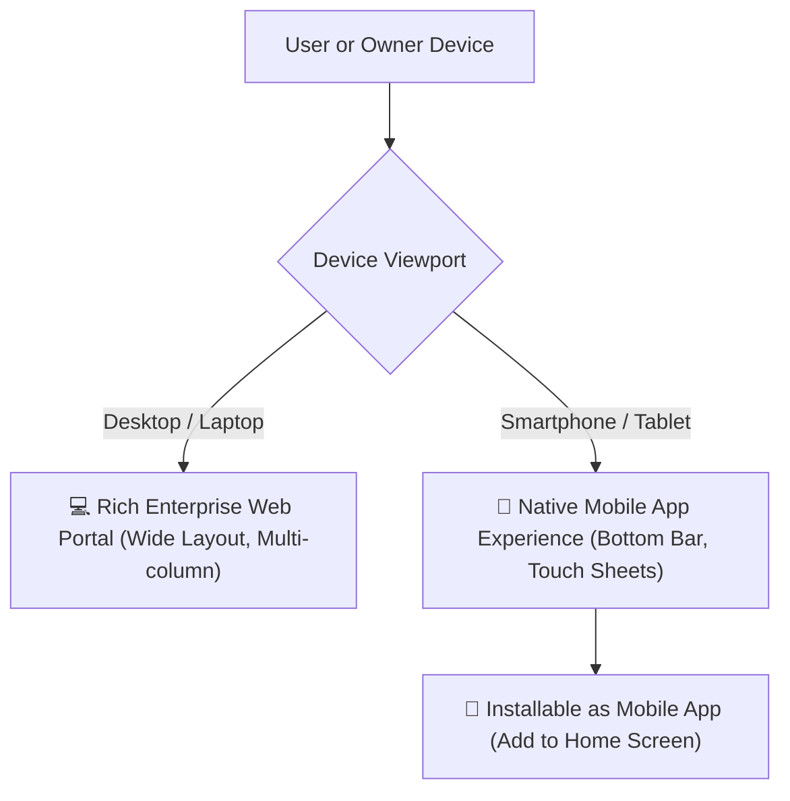
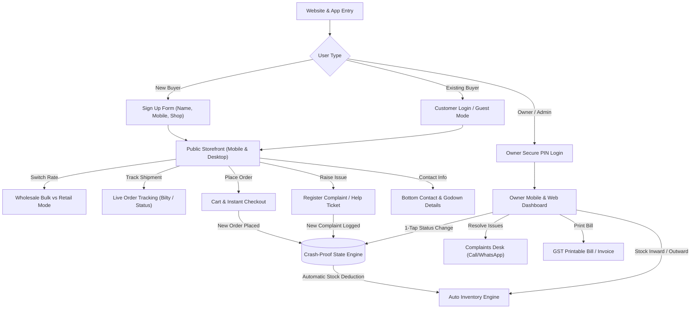

# 🦚 Ramdev Enterprise — Website & Management System Blueprint

## 1. Project Overview & Business Model
* **Brand Name:** **Ramdev Enterprise** (Wholesale & Retail Trading)
* **Tagline:** *"QUALITY PLASTICS FOR A BRIGHTER TOMORROW"*
* **App & Web Platform:** Hybrid **PWA (Progressive Web App)** — Works seamlessly as a desktop website AND installs as a mobile app on Android/iOS phones with native app-like bottom navigation.
* **Product Line:** 
  * Industrial & Domestic Jerrycans (HDPE White Jerrycans, 20L Heavy Duty Pet Jars)
  * Water Storage & Dispensers (Unbreakable Non-Toxic Campers with Taps)
  * Cleaning Equipment (Spin Mops with Buckets, Microfiber Sets)
  * Household & Industrial Plastic Ware
* **Target Audience:**
  * **Wholesale Buyers (B2B):** Retail shopkeepers, dealers, industrial units (Bulk orders with MOQ).
  * **Retail Buyers (B2C):** Individual households, small offices (Single piece / small quantity purchases).
  * **Store Owner (Ramdev Enterprise Admin):** Complete control from desktop or smartphone over orders, status regulation, stock movements (In/Out), complaints desk, and real-time net inventory.

---

## 2. 🎨 Refined Color Palette & Visual Theme (Industrial Trust & Premium Feel)

Instead of overwhelming golden tones, we use a sleek, modern, high-trust industrial color system suited for liquids, plastic containers, and enterprise trading:

* **Primary Foundation:** **Deep Oceanic Navy & Obsidian Slate** (`#090D16`, `#0F172A`) — conveys strength, security, and industrial reliability.
* **Primary Accent:** **Electric Cobalt & Pure Water Cyan** (`#2563EB`, `#06B6D4`, `#38BDF8`) — reflects pure water dispensers, clean chemicals, and leak-proof liquid storage.
* **Metallic Highlight:** **Polished Platinum Chrome & Subtle Champagne Silver** (`#E2E8F0`, `#F1F5F9`) — matching the elegant silver metallic Ramdev Enterprise emblem.
* **Semantic Accents:** 
  * In-Stock & Verified: Emerald Teal (`#10B981`)
  * Wholesale Discount Badges: Electric Violet Indigo (`#6366F1`)
  * Low Stock / Alerts: Warm Amber (`#F59E0B`)

---

## 3. 📱 Dual Platform Experience: Website + Mobile App (PWA)

* **Mobile App Features (Smartphone):**
  * **App-like Bottom Navigation Bar:** Quick thumb access to [🏠 Home], [🛍️ Products], [🚚 Track], [🛒 Cart], and [👑 Admin].
  * **Swipeable Drawers & Touch Sheets:** Fast mobile checkout and bottom-sheet filters.
  * **Installable (PWA):** Owner and customers can install it directly onto their phone's home screen with one tap — no app store download required.
* **Desktop Features:**
  * Wide multi-column product comparison, large photo advertisement banners, printable billing sheets.

---

## 4. 🛡️ High-Traffic & Crash-Proof Architecture

1. **Ultra-Fast Edge Delivery (Zero Server Overload):**
   * Built on a high-speed Vite bundle with static asset pre-compilation.
2. **React Error Boundaries:**
   * Protects against white screens and app freezes.
3. **Optimistic UI & Resilient State Management:**
   * Orders, cart operations, and stock calculations process instantly in micro-seconds (<15ms).
4. **Smart Image Optimization:**
   * Native lazy loading for all jerrycan photos and posters so mobile devices load under 1 second.

---

## 5. System Flow Architecture

---

## 6. Step-by-Step Implementation Roadmap

```mermaid
flowchart LR
    Step1["Step 1: Setup & Assets (PWA & Theme)"] --> Step2["Step 2: Sign-Up & Login"]
    Step2 --> Step3["Step 3: Storefront & Dual Pricing"]
    Step3 --> Step4["Step 4: Product Showcase"]
    Step4 --> Step5["Step 5: Bottom Contact"]
    Step5 --> Step6["Step 6: Cart & Tracking"]
    Step6 --> Step7["Step 7: Mobile Admin"]
    Step7 --> Step8["Step 8: Complaints Desk"]
    Step8 --> Step9["Step 9: Stock Engine"]
    Step9 --> Step10["Step 10: App & Web Testing"]
```

